# LAB-01 — Protección y privacidad de datos

**Materia:** Gestión de Seguridad y Desempeño de Bases de Datos
**Unidad:** II — Seguridad, privacidad y control de acceso
**Tema:** 2.3 — Datos sensibles, privacidad y protección de la información
**Estudiante:** _PALAFOX ESPINOZA MIGUEL ANGEL_
**Fecha:** 22 de octubre de 2026

-------------------------------------------------------------------------------------------------------------------

## Clasificación

Se analizo los atributos de la tabla `clientes` para decidir que datos requieren proteccion y que tipo de proteccion.

| Campo | ¿Identifica directamente? | ¿Puede contribuir a identificar? | ¿Requiere protección? | Justificación |
| --- | --- | --- | --- | --- |
| id | SI | SI | SI | Ya que es la clave primaria, y por lo cual vincula de manera precisa todos los datos del usuario. |
| nombre | SI | SI | SI | Ya que es un dato personal que identifica a una persona de manera directa. |
| correo | SI | SI | SI | Ya que es la dirección de contacto del usuario. |
| telefono | SI | SI | SI | Es el número de línea el cual este asignado a una persona. |
| rfc | SI | SI | SI | Contiene iniciales y fecha de nacimiento de la persona. |
| edad | NO | SI | SI, en combinación | Es un cuasificador. |
| ciudad | NO | SI | SI, en combinación | Es un dato geografico el cual es muy general. |
| codigo_postal | NO | SI | SI, en combinación | Es un cuasificador. |
| fecha_alta | NO | SI | SI, en combinación | Es un dato el cual el sistema lo genera, y no relaciona directamente al usuario. |

**Qué datos requieren protección y por qué**

- **Identificadores directos (id, nombre, correo, teléfono, RFC):** Estas permiten identificar a una persona sin tener que acceder a infomacion adicional, por lo que requieren los controles mas estrictos.
- **Cuasi-identificadores (edad, ciudad, código postal, fecha_alta):** Por si solos no identifican a un cliente, pero combinados podemos distinguir a un cliente dentro de un grupo pequeño. Por lo que se protegen mediante generalizacion y agregacion.

**Preguntas**

- **¿Qué campos identifican directamente a una persona?** `id`, `nombre`, `correo`, `telefono` y `rfc`.
- **¿Qué campos no identifican por sí mismos pero podrían contribuir a hacerlo?** `edad`, `ciudad`, `codigo_postal` y `fecha_alta`.
- **¿Qué combinación incrementa el riesgo de reidentificación?** La combinación de `edad` + `ciudad` + `codigo_postal` (y `fecha_alta`) aun después de eliminar el nombre. Si además se conserva un identificador directo como el nombre, el riesgo es máximo.
- **¿Todos los datos que deben protegerse son datos personales sensibles?** No. Todos los datos personales deben protegerse, pero los sensibles son los que afectan la esfera más íntima de la persona o cuyo uso indebido puede generar un riesgo particular. Nombre, correo o teléfono son datos personales, no necesariamente sensibles.

-------------------------------------------------------------------------------------------------------------------

## Enmascaramiento

**Qué se oculto.** En la vista `v_clientes_soporte` se oculto parcialmente el correo, el telefono y el RFC. El `id` y el `nombre` se muestran sin estar ocultos, porque el areande soporte necesita identificar al cliente.

**Para quien.** Para el rol `soporte`, que atiende las solicitudes de los clientes.

**Por que.** Soporte necesita identificar al cliente, pero no le es necesario ver correo, teléfono y RFC completos. Aqui aplicamos el principio de mínimo privilegio y de minimizacion de datos.

**Mecanismo utilizado.**

1. Se creó una vista `v_clientes_soporte`, que ocukta las columnas con `LEFT`, `RIGHT`, `SUBSTRING`/`POSITION` y `CONCAT`.
2. Se le otorgo `USAGE` sobre el esquema `public` y `SELECT` solo sobre la vista.
3. Se le revoco todo acceso directo a la tabla: `REVOKE ALL ON clientes FROM soporte;`.

**Resultado de `SELECT * FROM v_clientes_soporte;`:**
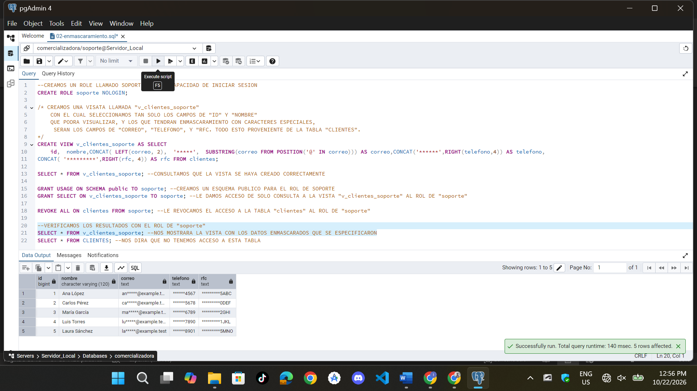


**Resultado de `SELECT * FROM clientes;` como `soporte`:**
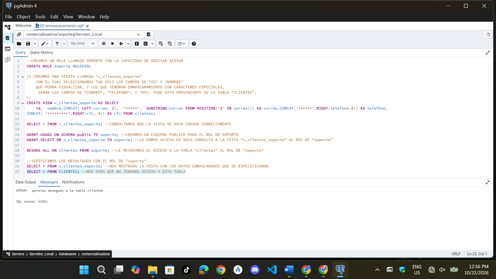

**Preguntas**

- **¿Qué información continúa existiendo en la tabla original?** ? Toda la infomacion, como el id del cliente, su nombre, su correo, su número de teléfono y rfc.
- **¿Qué información puede visualizar `soporte`?**? Solo puede visualizar el id del cliente y su nombre. Los demás los puede ver, pero con un formato enmascarado.
- **¿Por qué no es suficiente ocultar los datos solo en la aplicación?** Porque podrían ver esos datos los que son del área de desarrollo, si estos están desarrollando un sistema para el área de soporte. Y además de que, si cualquier persona tiene acceso a la base de datos, podrían visualizarlos.
- **¿Qué ocurriría si `soporte` tuviera acceso directo a `clientes`?** Podría ver todos los datos de los clientes, como podrían ser: correo, rfc y número de teléfono.

-------------------------------------------------------------------------------------------------------------------

## Seudonimización

**Cómo se generaron los tokens.** Se creo la tabla `pii.mapa_cliente` y se genero un token UUID aleatorio por cliente con `gen_random_uuid()`:

```sql
INSERT INTO pii.mapa_cliente (token, cliente_id)
SELECT gen_random_uuid(), id FROM clientes;
```

**Dónde se encuentra el mapa de correspondencia.** En `pii.mapa_cliente`, dentro del esquema `pii`, separado de los datos analiticos de `analitica.clientes` y de la tabla original `public.clientes`.

**Quién debería poder acceder a él.** Solo el DBA y mientras que el rol `analista` no tiene acceso.

**Por qué se separaron los permisos.** Si el mismo usuario pudiera consultar los datos seudonimizados y el mapa de correspondencia, este podría recuperar la identidad.

**Conjunto de datos para analítica.** La tabla `analitica.clientes` contiene `cliente_token`, `edad`, `ciudad`, `codigo_postal` y `fecha_alta`, sin nombre, correo, telefono ni RFC. El rol `analista` tiene `USAGE` sobre el esquema `analitica` y `SELECT` sobre esa tabla únicamente.

**Resultados de las consultas como `analista`:**
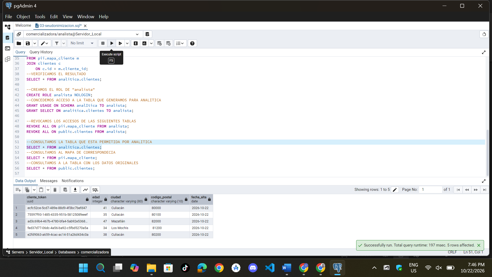
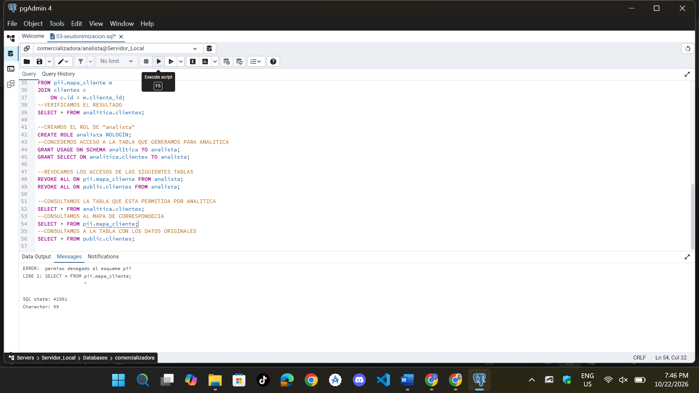
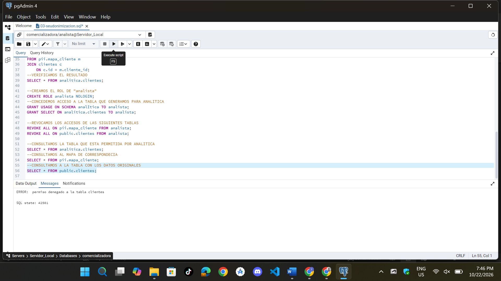

**Preguntas**

- **¿Qué ocurriría si `analista` pudiera consultar `pii.mapa_cliente`?** Podría ver que token le pertenece a cada id de cada cliente.
- **¿Qué principio se aplica al separar ambos accesos?** La separación de roles o funciones.
- **¿Por qué la seudonimización no equivale a anonimización?** Porque con la seudonimizacion puedo recuperar de alguna forma la identidad de un registro mientras que con la anonimizacion no puedo recuperarla de ninguna forma.
- **¿Qué información permite volver a relacionar el token con una persona?** La tabla `pii.mapa_cliente` ya que almacena la relación precisa entre el token y el `id` del cliente original.

**Riesgo que permanece.** Aunque el rol de analista no pueda ver el mapa de corresponcencia, los campos: `edad`, `ciudad`, `codigo_postal` y `fecha_alta` siguen siendo cuasi-identificadores. Que una base tan pequeña, ciertas combinaciones podrían señalar a una persona concreta.

-------------------------------------------------------------------------------------------------------------------

## Anonimización

La anonimización se aplico para el area que solo necesita infomacion estadistica.

**Qué identificadores fueron eliminados.** Los identificadores `id`, `nombre`, `correo`, `telefono` y `rfc`.

**Qué atributos fueron generalizados.**

- La `edad` con los rangos: `18-30`, `31-45`, `46+`.
- El `codigo_postal` con la region, en los dos primeros dígitos (`LEFT(codigo_postal, 2)`).

**Resultados obtenidos**
```sql
SELECT CASE WHEN edad BETWEEN 18 AND 30 THEN '18-30' 
	WHEN edad BETWEEN 31 AND 45 THEN '31-45'
	ELSE '46+'   END AS rango_edad, COUNT(*) AS total 
FROM clientes GROUP BY 1;
```
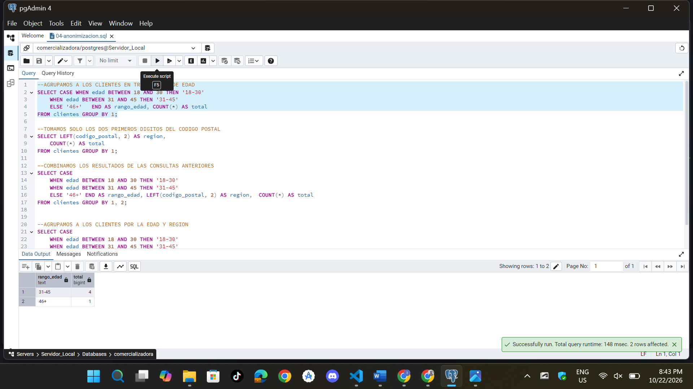

```sql
SELECT LEFT(codigo_postal, 2) AS region, 
	COUNT(*) AS total 
FROM clientes GROUP BY 1;
```
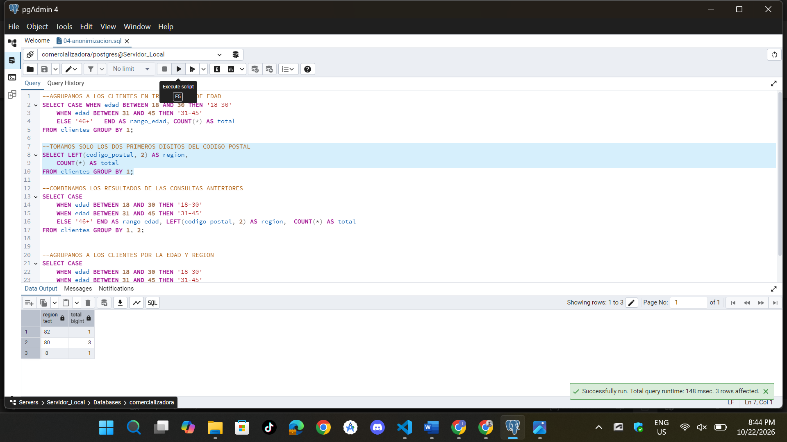

```sql
SELECT CASE
	WHEN edad BETWEEN 18 AND 30 THEN '18-30'
	WHEN edad BETWEEN 31 AND 45 THEN '31-45'
	ELSE '46+' END AS rango_edad, LEFT(codigo_postal, 2) AS region,  COUNT(*) AS total
FROM clientes GROUP BY 1, 2;
```
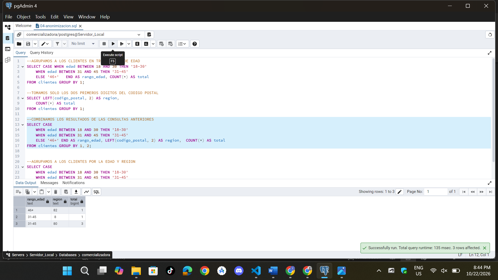

```sql
SELECT CASE
	WHEN edad BETWEEN 18 AND 30 THEN '18-30'
	WHEN edad BETWEEN 31 AND 45 THEN '31-45'
	ELSE '46+'   END AS rango_edad,   LEFT(codigo_postal, 2) AS region, COUNT(*) AS total
FROM clientes GROUP BY 1, 2 HAVING COUNT(*) >= 5;
```
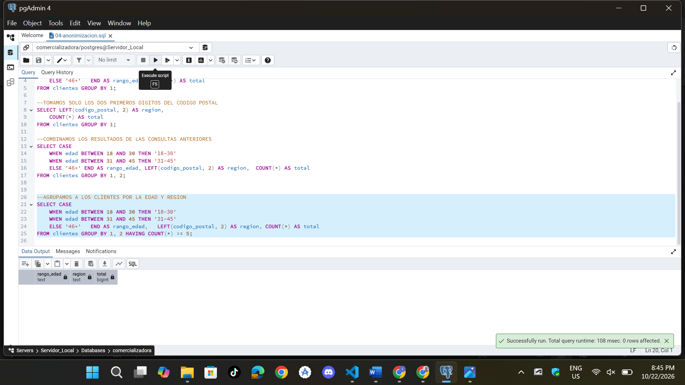


**Qué grupos fueron suprimidos.** Todos ya que con la combinacion que realizamos, estos quedaron por debajo del umbral.

### Análisis del riesgo de reidentificación

- **¿Qué identificadores directos fueron eliminados?** `id`, `nombre`, `correo`, `telefono` y `rfc`.
- **¿Qué cuasi-identificadores permanecen?** Los que son los rangos de edad y de la region postal.
- **¿Qué combinaciones podrían reducir el anonimato?** Podrian ser el rango de edad con la región.
- **¿Qué sucede cuando un grupo contiene pocos registros?** Es más facil distinguir a una persona.
- **¿Qué atributos deberían generalizarse?** El Codigo postal, la edad pero con rangos mas amplios, la `fecha_alta` por año y `ciudad` si se publica junto con otros atributos.
- **¿Qué información debería suprimirse?** Los grupos que estan por debajo del umbral.
- **¿Es correcto afirmar que el conjunto de datos es "100 % anónimo"?** No, ya que al eliminar identificadores directos y agruparlos solo reduce el riesgo, pero no lo elimina.

### Reto

**Cambio realizado.** Se ampliaron los rangos de edad y se redujo el detalle geográfico:

```sql
SELECT
    CASE
        WHEN edad BETWEEN 18 AND 49 THEN '18-49'
        ELSE '50+'
    END AS rango_edad,
    LEFT(codigo_postal, 1) AS region,
    COUNT(*) AS total
FROM clientes
GROUP BY 1, 2
HAVING COUNT(*) >= 5;
```
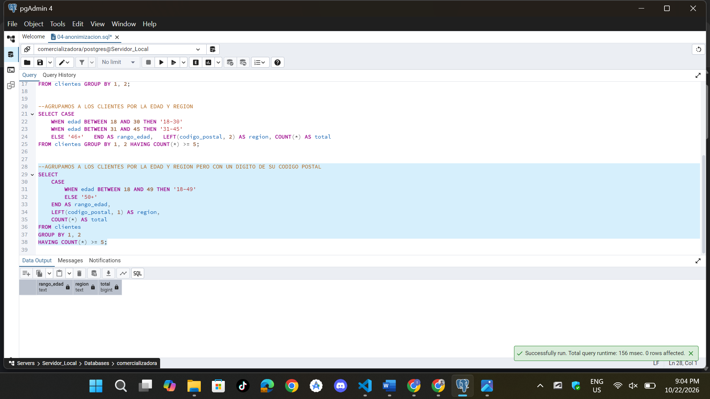

**Motivo:** Con rangos y regiones mas amplios, los registros se agrupan en conjuntos mayores y es mucho mas dificil poder identificar a un cliente.

**Resultado obtenido:**
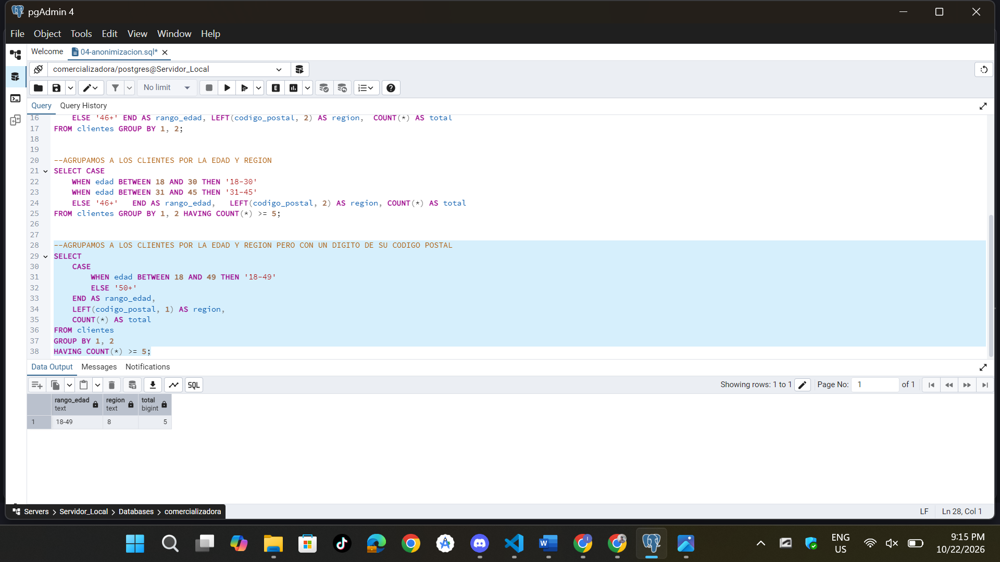

**Riesgo que se pretende reducir:** La distincion de clientes en los grupos pequeños con combinacion de edad y region.

**Limitación:** El grupo resultante aporta casi nada de informacion util.

**Riesgo de reidentificación que permanece:** Aunque se cumpla el umbral, sigue existiendo riesgo si el conjunto se cruza con otras fuentes o si se publican varias consultas distintas sobre los mismos datos, porque la comparación entre resultados puede revelar información. El control de acceso sobre las tablas originales sigue siendo necesario.

-------------------------------------------------------------------------------------------------------------------

## Retención

**Criterio utilizado.** Para el ejercicio aplique un periodo de cinco años desde `fecha_alta`.

**Consulta para identificar los registros afectados:**

```sql
SELECT *
FROM clientes
WHERE fecha_alta < CURRENT_DATE - INTERVAL '5 years';
```
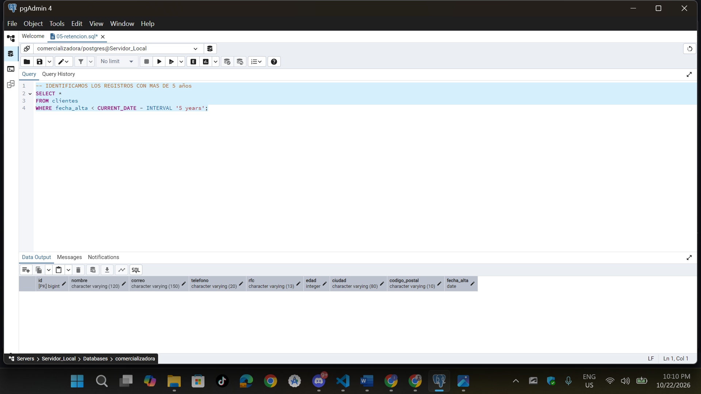

**Registros afectados:** Como `fecha_alta` toma por defecto la fecha del dia que ingresamos el registro (`CURRENT_DATE`), con los datos de prueba la consulta devuelve **0 filas**, ya que ningun cliente excede el periodo. La consulta queda lista para usarse cuando existan registros antiguos. **No se ejecutó ningún `DELETE` sobre la tabla principal.**

**Justificación del periodo:** Por el tratamiento, las necesidades operativas, y las obligaciones legales, el cual debe validarlo el area juridica o de cumplimiento.

**Qué información debería conservarse:** Los datos necesarios mientras exista la relacion con el cliente y durante los plazos legales, contractuales o de auditoria aplicables.

**Qué información podría eliminarse:** Los datos personales de los clientes que cuya relacion termino y el plazo de conservacio ya termino, y tambien los que ya no tienen una finalidad vigente.

**Controles que deberían existir antes de eliminar.**

1. **Aprobación:** Autorizacion del responsable de los datos, con revision del area legal.
2. **Respaldo:** Realizar un respaldo de los registros a eliminar, con su integridad comprobada.
3. **Evidencia:** Registro del criterio aplicado, la consulta que se ejecuto, el numero y los identificadores de registros que fueron afectados, quien aprobo, quien lo ejecuto y la fecha.
4. **Procedimiento de recuperación:** si se elimino la informacion por error, restaurarla desde el respaldo en un entorno controlado y reinsertar solo los registros afectados.
5. **Ejecución controlada:** Primero identificar y revisar los registros que seran afectados, para luego eliminarla mediante un proceso aprobado.

-------------------------------------------------------------------------------------------------------------------

## Conclusiones

**¿Qué técnica utilizaría para un área de soporte?**
**Enmascaramiento mediante una vista, un con control de acceso:** El area de `soporte` solo necesita identificar al cliente y operar con sus datos, pero no necesita verlos completamente. Que la vista muestra lo necesario y se le restringe el acceso a la tabla original `clientes`.

**¿Qué técnica utilizaría para un área de analítica?**
**Seudonimización con separación de funciones:** Analitica solo necesita estudiar patrones entre los datos sin necesidad de ocupar la identidad del clientes. Utilizando tokens sustituyen que sustituyen al identificador con un mapa de correspondencia, los cuales no tendran acceso para el analista.

**¿Qué técnica utilizaría para publicar estadísticas?**
**Anonimización mediante generalización y agregación:** Direccion solo necesita informacion agregada.

**¿Por qué ninguna de estas técnicas sustituye al control de acceso?**
Porque cada técnica reduce una parte del riesgo que tenemos, pero ninguna impide que por si sola un usuario no autorizado llegue a los datos originales. El enmascaramiento solo cambia la visualizacion pero el dato original sigue en la tabla, con la seudonimización es reversible ya que si alguien accede al mapa puede ver los datos originales, mientras que con la anonimizacion puede fallar si hay cuasidentificadores, que sin permisos bien definidos cualquier usuario podria saltarse la transformacion y consultar la tabla original.

-------------------------------------------------------------------------------------------------------------------

## Preguntas de reflexión

1. **¿Cuál es la diferencia entre enmascaramiento y seudonimización?**
   El enmascaramiento oculta solo la visualización de un dato, pero el dato original sigue existiendo, de manera accesible para alguien tenga los permisos. La seudonimización solo sustituye el identificador directo por un token y mantiene aparte la informacion que permite volver a visualizarla.

2. **¿Por qué la seudonimización no significa anonimización?**
   Porque existe el mapa de correspondencia,el cual permite reidentificar a un cliente. Mientras que en la anonimización no debería existir un medio para hacerlo.

3. **¿Por qué eliminar nombre y RFC no garantiza que un conjunto de datos sea anónimo?**
   Porque los cuasi-identificadores como la edad, ciudad, codigo postal, y la fecha de alta pueden combinarse entre si o con otras fuentes para identificar a un cliente.

4. **¿Qué función tienen los cuasi-identificadores?**
   Por si solos no podemos identificar a un cliente, pero combinados con otros datos contribuyen a identificarlo.

5. **¿Por qué es importante separar el mapa de seudonimización?**
   Porque quien tenga acceso a los datos seudonimizados y al mapa puede recuperar la identidad. Pero al separarlos, ningun usuario con acceso solo a los datos analíticos puede reidentificar a las personas.

6. **¿Qué principio se aplica al impedir que el analista acceda al mapa?**
   La separacion de funciones y con el mínimo privilegio, ya que el analista recibe solo los permisos necesarios para analizar la informacion.

7. **¿Por qué una vista puede ser preferible a entregar acceso directo a la tabla?**
   Porque nos permiten controlar que columnas y filas podemos mostrar y en que forma, sin necesidad de otorgar acceso a la tabla original, que contiene todos los datos completos.

8. **¿Qué diferencia existe entre proteger un dato para visualización y protegerlo contra acceso no autorizado?**
   Proteger la visualizacion cambia lo que se muestra, pero el dato original sigue almacenado y puede obtenerse si el usuario tiene acceso a la fuente. Mientras que proteger contra acceso no autorizado impide que quien no esta autorizado, pueda llegar a consultarla,  esto mediante roles, permisos, esquemas y separacion de funciones.

9. **¿Por qué la retención forma parte de la protección de datos?**
   Porque la organización solo necesita conservar los datos mientras exista una finalidad o una obligacion que lo justifique.

10. **¿Qué riesgo existe si una organización conserva información indefinidamente?**
   Aumenta la cantidad de datos que pueden exponerse ante un incidente, causando un impacto a los titulares de esos datos.